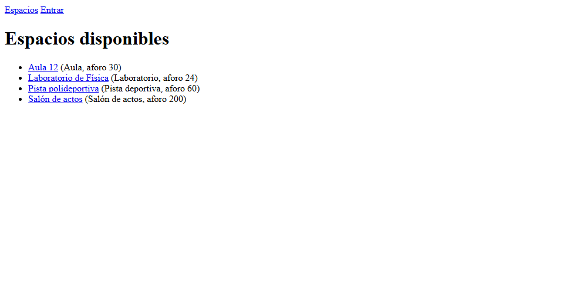
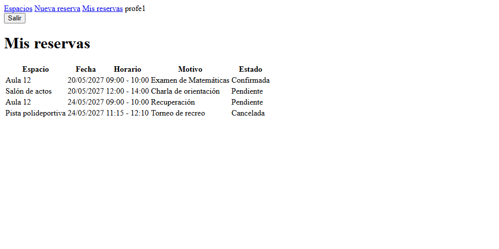
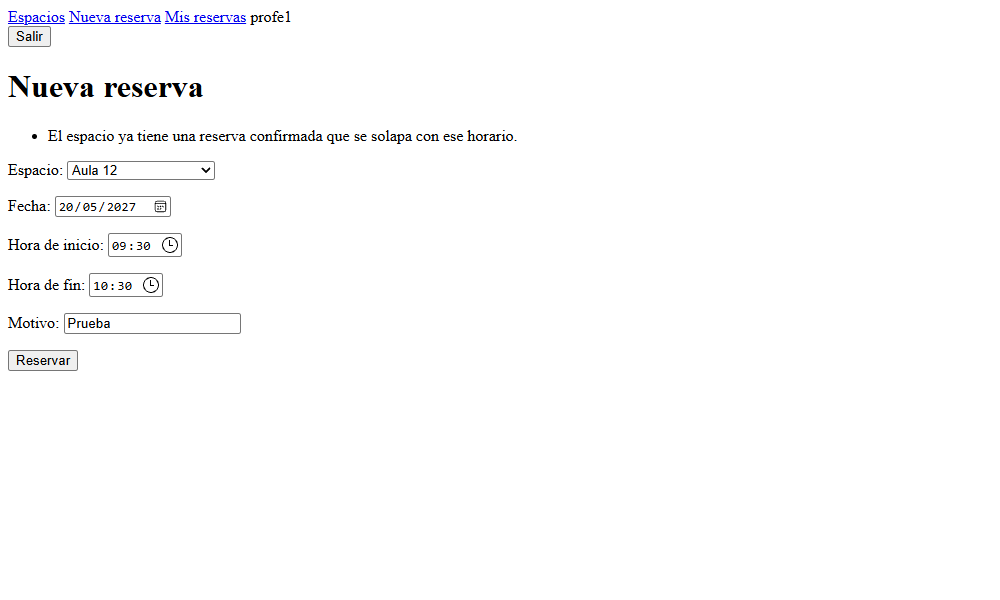
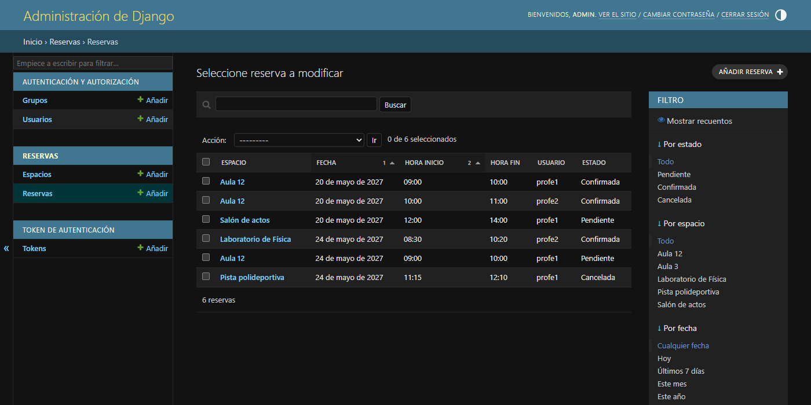
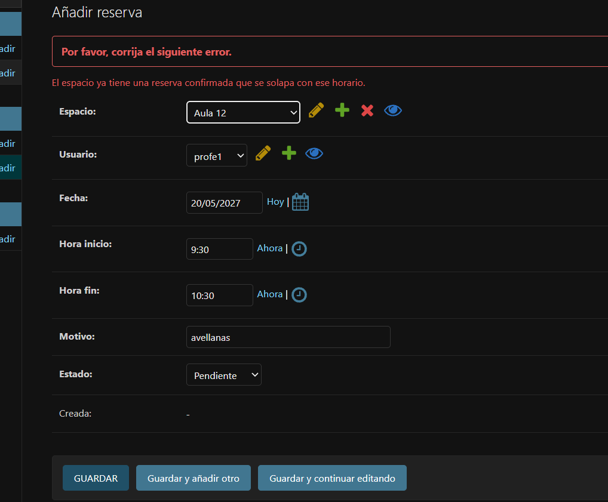
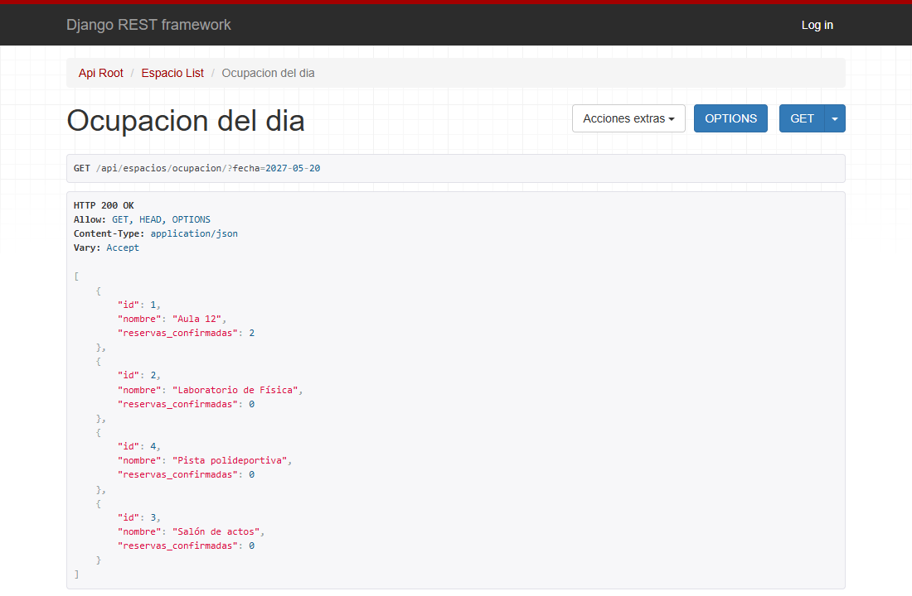
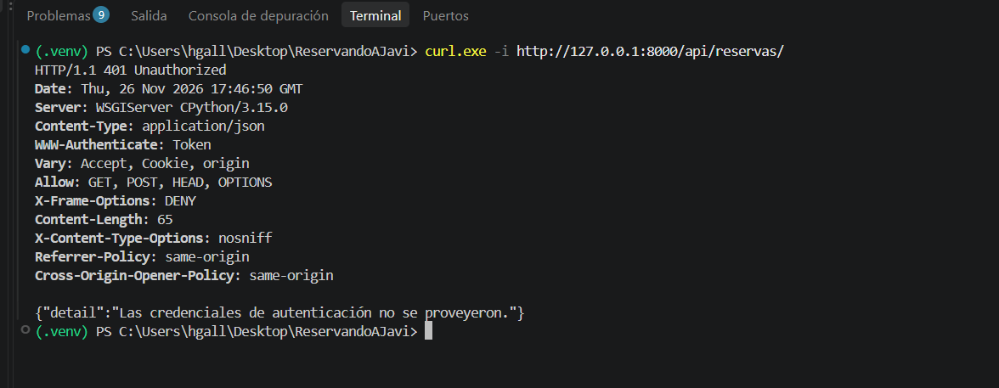
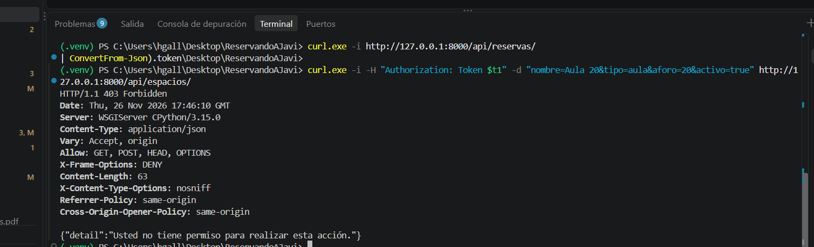
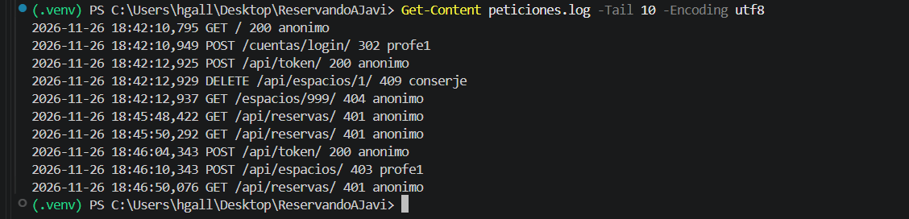

# UT2-P01. Back-end de la aplicación de reservas

Aplicación de reservas de espacios del IES Hontanilla, hecha con Django y Django REST Framework: páginas web, panel de administración y API REST.

Permite llevar un control de las aulas y demás espacios: ver los que están disponibles y, tras iniciar sesión, hacer reservas y consultar las propias. Los usuarios se crean desde el panel de administración.

## Arrancar el proyecto desde cero (Windows, PowerShell)

Hace falta tener instalados Python y Git.

```powershell
git clone https://github.com/Hugopairo/ReservandoAJavi.git reservas
cd reservas
python -m venv .venv
.\.venv\Scripts\Activate.ps1
python -m pip install -r requirements.txt
python manage.py migrate
python manage.py cargar_datos
python manage.py runserver
```

La web queda en <http://127.0.0.1:8000/>, el panel en <http://127.0.0.1:8000/admin/> y la API en <http://127.0.0.1:8000/api/>.

`cargar_datos` crea 5 espacios, 6 reservas y estos usuarios de prueba, todos con la contraseña `Clave.2026`:

| Usuario | Tipo |
|---|---|
| `profe1` | Profesorado |
| `profe2` | Profesorado |
| `conserje` | Personal (puede gestionar espacios desde la API) |

Para entrar en el panel de administración hay que crear un superusuario:

```powershell
python manage.py createsuperuser
```

## Capturas

### Listado de espacios



### «Mis reservas» de profe1



### Error de solape en el formulario



### Panel de administración con el filtro de reservas



### Error de solape en el panel de administración



### Ocupación del 20/05/2027



### Error 401 en la API



### Error 403 en la API



### Últimas líneas de peticiones.log



## Pruebas de la API con curl.exe

Con el servidor arrancado, en otra terminal.

Raíz de la API y listado de espacios (200, sin identificarse):

```powershell
curl.exe http://127.0.0.1:8000/api/
```

```powershell
curl.exe http://127.0.0.1:8000/api/espacios/
```

Ocupación de un día:

```powershell
curl.exe "http://127.0.0.1:8000/api/espacios/ocupacion/?fecha=2027-05-20"
```

Pedir los tokens y guardarlos en variables:

```powershell
$t1 = (curl.exe -s -X POST -d "username=profe1&password=Clave.2026" http://127.0.0.1:8000/api/token/ | ConvertFrom-Json).token
```

```powershell
$t2 = (curl.exe -s -X POST -d "username=profe2&password=Clave.2026" http://127.0.0.1:8000/api/token/ | ConvertFrom-Json).token
```

Reservas sin token (401):

```powershell
curl.exe -i http://127.0.0.1:8000/api/reservas/
```

Reservas de un día con token (200):

```powershell
curl.exe -i -H "Authorization: Token $t2" "http://127.0.0.1:8000/api/reservas/?fecha=2027-05-20"
```

Un profesor intenta crear un espacio (403):

```powershell
curl.exe -i -H "Authorization: Token $t1" -d "nombre=Aula 20&tipo=aula&aforo=20&activo=true" http://127.0.0.1:8000/api/espacios/
```

Reserva que se solapa (400):

```powershell
curl.exe -i -H "Authorization: Token $t2" -d "espacio=1&fecha=2027-05-20&hora_inicio=09:30&hora_fin=10:30&motivo=Prueba" http://127.0.0.1:8000/api/reservas/
```

CORS con un origen permitido (aparece `access-control-allow-origin`) y con uno no permitido (no aparece):

```powershell
curl.exe -i -H "Origin: http://localhost:5173" http://127.0.0.1:8000/api/espacios/
```

```powershell
curl.exe -i -H "Origin: http://localhost:8080" http://127.0.0.1:8000/api/espacios/
```

## Avisos de `check --deploy`

```powershell
python manage.py check --deploy
```

Salen 7 avisos. Son normales en desarrollo; en un servidor de producción habría que resolverlos.

| Aviso | Qué significa | Cómo se resolvería en producción |
|---|---|---|
| W004 | No se le dice al navegador que recuerde usar siempre HTTPS con esta web. | Poner `SECURE_HSTS_SECONDS` con un valor en segundos, empezando por uno pequeño y solo cuando HTTPS funcione bien. |
| W008 | Las peticiones HTTP no se redireccionan a HTTPS. | `SECURE_SSL_REDIRECT = True`, o hacer la redirección en el servidor web. |
| W009 | La clave actual (`SECRET_KEY`) es de desarrollo y no es segura; la de producción no se puede publicar. | Generar una clave larga y aleatoria y leerla de una variable de entorno, sin subirla al repositorio. |
| W012 | La cookie de sesión puede viajar sin cifrar y se puede robar: quien la intercepte entra con tu sesión sin saber la contraseña. De esto habló un hacker joven en un pódcast con Nill Ojeda. | `SESSION_COOKIE_SECURE = True`, para que solo viaje por HTTPS. |
| W016 | La cookie CSRF podría viajar sin cifrar. | `CSRF_COOKIE_SECURE = True`. |
| W018 | Con `DEBUG` activado, las páginas de error pueden mostrar detalles internos. | `DEBUG = False`. |
| W020 | No se han indicado los dominios que Django puede atender (`ALLOWED_HOSTS` está vacío). | Poner en la lista el dominio o la IP del servidor. |
